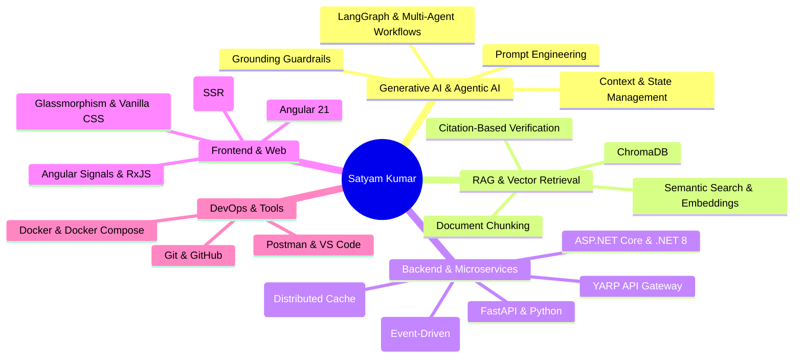

# Satyam Kumar — GenAI & Backend Engineer

<div align="center">

[](https://www.linkedin.com/in/satyam-kumar-250263367)
[](https://github.com/Satyamglacs22)
[](mailto:sk72574401@gmail.com)
[](http://localhost:4200/)

<p align="center">
  <strong>Software Analyst @ Capgemini</strong> | <strong>Anthropic & Microsoft Certified AI Developer</strong><br/>
  Specializing in <strong>Generative AI</strong>, <strong>LangGraph Multi-Agent Systems</strong>, <strong>Enterprise RAG</strong>, and <strong>.NET Microservices</strong>.
</p>

</div>

---

## 📌 Executive Summary

Software Analyst at **Capgemini** with comprehensive hands-on experience in distributed backend development, .NET microservices, Python, and modern Generative AI architectures. 

* 🤖 **Agentic & Generative AI:** Engineering autonomous multi-agent systems with **LangGraph**, intent routing, persistent memory, and state machines.
* 🔍 **Enterprise RAG:** Building high-precision semantic retrieval platforms using **ChromaDB**, document chunking, and source-citation guardrails.
* 🌐 **Distributed Systems:** Architecting event-driven microservices with **.NET 8**, **RabbitMQ**, **Redis caching**, **YARP API Gateway**, and **Docker**.
* ⚡ **Modern Frontend:** Developing reactive single-page applications using **Angular 21** (Signals, RxJS, and SSR).

---

## 🚀 Key Highlights & Metrics

| Metric | Detail |
| :--- | :--- |
| **Current Role** | **Software Analyst** at **Capgemini** (Bengaluru, India) |
| **GenAI Platforms** | **2+** Production-grade platforms (Multi-Agent Copilot & Enterprise RAG) |
| **Distributed Architecture** | **8 Microservices** (.NET 8, YARP, RabbitMQ, Redis, Docker) |
| **Professional Certifications** | **Claude Certified Developer** (Anthropic) & **Agentic AI Developer** (Microsoft) |
| **Education** | B.Tech in CSE, **GLA University** (CPI: **7.96**) |
| **Algorithmic Problem Solving** | **100+ DSA Problems** Solved (LeetCode, GFG) \| **Rank 7,671** LeetCode Weekly Contest |

---

## 🛠️ Technical Expertise



### Categorized Skills

* **Languages:** Python, C#, JavaScript, TypeScript, SQL
* **Agentic AI:** LangChain, LangGraph, Multi-Agent Systems, State Management, Agent Routing, Memory, Workflow Orchestration
* **GenAI & RAG:** Prompt Engineering, Embeddings, Semantic Search, Context Management, Grounded Responses, Guardrails
* **Vector Databases:** ChromaDB, Vector Search, Similarity Retrieval
* **AI Engineering:** LangSmith, Tracing, Model Evaluation, Context Engineering
* **Backend:** FastAPI, ASP.NET Core Web API, .NET 8, REST APIs, SQLAlchemy
* **Microservices:** RabbitMQ, Redis, API Gateway (YARP), JWT Authentication, Event-Driven Architecture
* **Frontend:** Angular 21, Signals, RxJS, SSR, HTML5, Modern CSS / Glassmorphism
* **Databases:** SQL Server, SQLite, MySQL, Redis
* **DevOps & Tools:** Docker, Docker Compose, Git, GitHub, Postman, Visual Studio, VS Code

---

## 💻 Featured Projects

### 1. [E-Commerce Multi-Agent AI Shopping Copilot](https://github.com/Satyamglacs22)
> **Stack:** `Python` • `LangGraph` • `Multi-Agent Systems` • `RAG` • `State Management`
* Built an autonomous multi-agent platform coordinating dedicated shopping and customer support agents.
* Implemented agent orchestration, persistent state management, context passing, memory, and intent-based routing to coordinate complex multi-step transactions.
* Integrated RAG-based grounding and validation guardrails to ensure context-aware, verifiable product recommendations.

### 2. [Enterprise Banking Policy & Compliance RAG Platform](https://github.com/Satyamglacs22)
> **Stack:** `Python` • `FastAPI` • `Angular` • `ChromaDB` • `RAG` • `Semantic Embeddings`
* Engineered an enterprise-oriented RAG platform for low-latency, high-precision retrieval across complex banking regulatory and compliance documentation.
* Implemented automated document chunking, semantic embeddings, and vector similarity search using **ChromaDB**.
* Developed multilingual retrieval with source-citation grounded responses, eliminating hallucination risks.

### 3. [ConnectSphere — Microservices Social Media Platform](https://github.com/Satyamglacs22)
> **Stack:** `C#` • `.NET 8` • `Angular 21` • `RabbitMQ` • `Redis` • `Docker` • `YARP`
* Architected a distributed social media platform powered by **8 microservices** behind a **YARP API Gateway**.
* Utilized **RabbitMQ** for event-driven asynchronous messaging and **Redis** for distributed feed caching.
* Secured all services with **JWT authentication**, containerized with **Docker Compose**, and built a reactive **Angular 21** frontend with Signals, RxJS, and SSR.

### 4. Healthcare Management System
> **Stack:** `C#` • `.NET` • `SQL Server` • `CRUD Architecture`
* Developed a database-driven app to manage patient records, appointments, and doctor schedules with optimized SQL Server query design and complete CRUD capabilities.

### 5. Environmental Monitoring Dashboard
> **Stack:** `Node.js` • `Express` • `JavaScript` • `HTML5/CSS3`
* Built a real-time environmental telemetry dashboard to monitor air and water quality metrics as a capstone project during full-stack training.

---

## 🏆 Certifications & Honors

1. **Claude Certified Developer – Foundations** *(Anthropic)*
   * Frontier foundation models, prompt engineering, context management, API integration, and model alignment.
2. **GitHub Certified: Agentic AI Developer** *(Microsoft & GitHub)*
   * Multi-agent architectures, autonomous agent workflows, state machine orchestration, tool use, and agent memory.
3. **Full Stack Backend using Node.js** *(Coding Blocks & GLA University - July 2024)*
   * RESTful APIs, asynchronous backend architecture, and relational/NoSQL database modeling.

---

## 💼 Professional Experience

```
Capgemini (Bengaluru, India)
├── Software Analyst [July 2026 – Present]
│   ├── Designing enterprise-grade backend services and microservices using C# and .NET 8.
│   ├── Implementing clean architecture, secure REST APIs, and automated test pipelines.
│   └── Exploring and integrating GenAI and agentic automation workflows into backend engineering.
│
└── Company Engineering Training Program (Exceller Edge) [Dec 2025 – May 2026]
    ├── Completed intensive enterprise training in C#, .NET Core, OOP, and NUnit testing.
    └── Graduated with distinction into the full-time Software Analyst role.

GLA University (Coding Blocks)
└── Full Stack Backend Trainee [Jun 2024 – Jul 2024]
    └── Hands-on backend training in Node.js, Express, and REST APIs; delivered capstone dashboard.
```

---

## 🌐 About This Portfolio Project

This repository houses the source code for my interactive developer portfolio, built with **Angular 21**:

* **Framework:** Angular 21 (Standalone Components, Signals State Management)
* **Design System:** Custom Dark Glassmorphism, CSS Custom Properties, Cyber Gradient Accents
* **Interactions:** Custom mouse follower, intersection observer scroll reveals, and responsive typography
* **Direct Resume Access:** In-browser PDF view and instant download options

### 🏃 Running Locally

#### Prerequisites
* **Node.js** (v20+ recommended)
* **npm** (v10+)

#### Steps
```bash
# 1. Clone repository
git clone https://github.com/Satyamglacs22/PortfolioSks.git

# 2. Navigate to project root
cd PortfolioSks

# 3. Install dependencies
npm install

# 4. Start local development server
npm start
# Alternatively: npx ng serve

# 5. Open in browser
# Navigate to http://localhost:4200/
```

#### Production Build
```bash
npm run build
```
The optimized bundle will be generated in the `dist/` directory.

---

## 📬 Contact & Connect

* **Location:** Begusarai, Bihar / Bengaluru, India
* **Email:** [sk72574401@gmail.com](mailto:sk72574401@gmail.com)
* **Phone:** +91 9123195281
* **LinkedIn:** [linkedin.com/in/satyam-kumar-250263367](https://www.linkedin.com/in/satyam-kumar-250263367)
* **GitHub:** [github.com/Satyamglacs22](https://github.com/Satyamglacs22)

---

<div align="center">
  <sub>Designed & Developed by Satyam Kumar. © 2026 All Rights Reserved.</sub>
</div>
